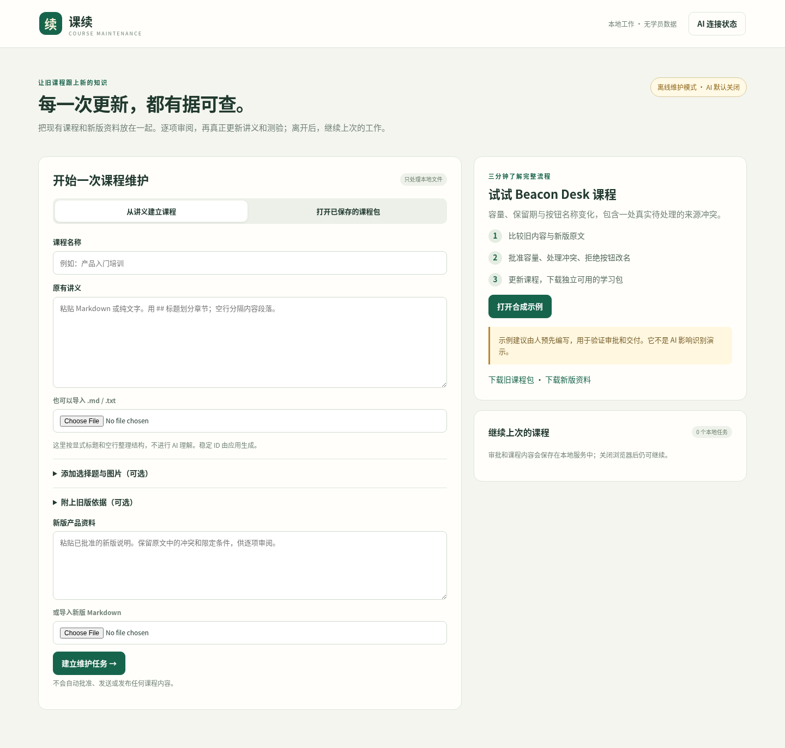
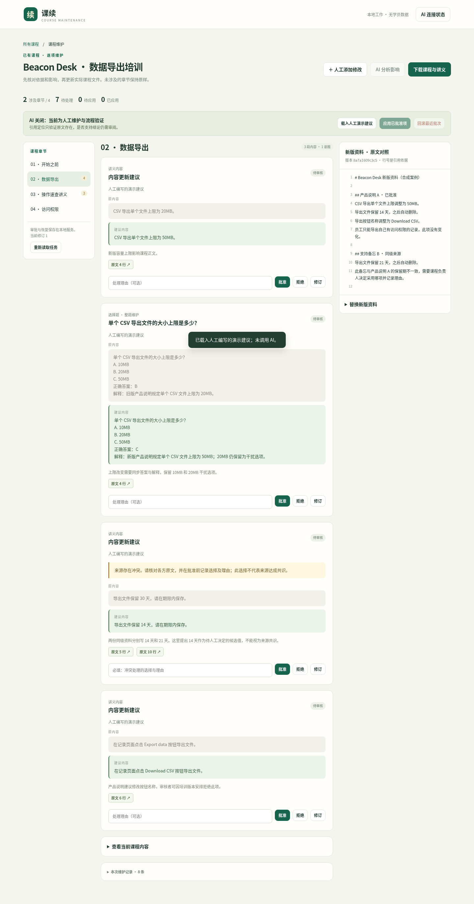
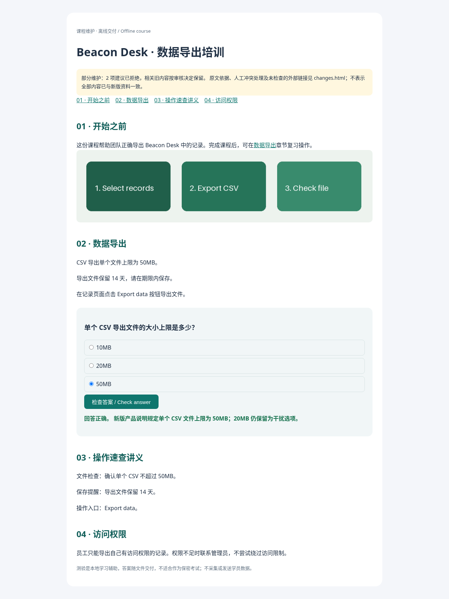

[English](README.md)

# 课续 · 培训课程维护

把新版产品资料落实到已有课程：查看带原文依据的修改建议，逐项批准或拒绝，真正更新课程文件，交付能学习、能答题、能打印讲义的课程包。

**当前状态：本地离线人工维护闭环可用；真实 AI 影响识别尚未 live 验证。** 默认服务拒绝模型调用和凭据配置。内置建议明确标注为人工编写的合成案例，不能当成 AI 结果。市场需求与相对已有课程工具的差异仍待验证。



## 已完成

- 粘贴或导入自己的 Markdown／纯文字讲义，通过表单添加选择题和本地图片。应用生成稳定 ID 与可复用 `.course.zip`，培训人员无需手写 JSON。
- 打开保存的课程包与新版 Markdown，查看原文行号、新旧内容、影响章节、来源冲突和缺失依据。
- 逐项批准／拒绝／修订建议，记录人工处理冲突的理由。选择题整题维护，保留干扰项，不做全局数字替换。
- 更新持久 SQLite 状态及实际 `course.json`；重启继续、重复点击幂等、最近批次可回滚。
- 导出互动 `course.html`、`handout.html`、课程 JSON、来源资料、素材和可读／机器可读变更记录。拒绝项明确披露，不声称全部内容已符合新资料。
- 已实现真实 OpenAI-compatible 建议适配器，默认关闭；配置只存内存，不搜索凭据，不自动重试付费请求，所有建议必须人工审阅。



## 本地启动

需要 Python 3.11+ 和当前桌面浏览器。仅启动一个服务进程并绑定回环地址，无需账号或远端仓库。安装依赖需要普通软件包访问；以下命令不调用模型服务。

**Linux / macOS**

```sh
python3 -m venv .venv
.venv/bin/python -m pip install -r requirements.txt
.venv/bin/python -m uvicorn app.main:app --host 127.0.0.1 --port 8765
```

**Windows PowerShell**

```powershell
py -3 -m venv .venv
.venv\Scripts\python.exe -m pip install -r requirements.txt
.venv\Scripts\python.exe -m uvicorn app.main:app --host 127.0.0.1 --port 8765
```

打开 `http://127.0.0.1:8765`。界面为简体中文。本次实际验证了 Linux/Chromium；Windows/macOS 命令尚未实跑。首版是单人本地工具，没有托管多租户能力。

## 如何放入自己的第一份课程

1. 选择**从讲义建立课程**，填写名称并粘贴／导入 `.md` 或 `.txt`。`## 标题` 划分章节，空行分隔段落；这是显式格式整理，不是 AI 语义解析。
2. 按需添加选择题：2–6 个选项、一个正确答案、解释；上传 PNG/JPEG/WebP 图片及说明，选择所属章节。
3. 放入新版资料，建立任务。通过**人工添加修改**选择内容和原文行号，保存建议，再审阅批准。离线模式不会自动识别影响。
4. 应用批准项，处理或拒绝其余建议，下载课程与讲义。下次更新时重新打开这个课程包即可。

暂不支持 PPTX、PDF、任意 HTML、视频、远程素材、SCORM/LMS 或保密考试。Markdown 仅支持限定的文字、章节与链接，不是完整渲染器。完整格式见[输入与验收契约](CONTRACT.md)。

## 演示与可审查成果

打开 **Beacon Desk** 并明确点击**载入人工演示建议**。批准 50MB 容量和题目修改；针对 14／21 天冲突，选择 14 天并记录理由；拒绝两处按钮改名。最终保留 `Export data` 与 `20MB` 干扰选项，正确答案改为 C=`50MB`，解释同步。两个无关章节的数据对象逐字保持原样。

- [实际导出的合成课程包](evidence/beacon-maintained.course.zip)
- [浏览器验收记录](evidence/browser-check.json)
- [中断恢复证据](evidence/recovery-proof.json)
- [验收报告与局限](docs/VALIDATION.md)



解压后，`course.html` 按自包含文档设计。**本环境浏览器策略禁止 `file://`，所以直接双击打开尚未验证。** 实际验证的方式是让导出目录使用独立本地静态服务，与作者应用无关：

```sh
python -m http.server 8766 --bind 127.0.0.1 --directory path/to/extracted-course
```

打开 `http://127.0.0.1:8766/course.html` 或 `handout.html`。验收时作者服务已停止，使用新浏览器进程和新 profile，从独立地址载入后关闭网络，再检查图片与评分。没有外部资源请求，素材内嵌，不依赖作者浏览器私有缓存。测验用于学习，答案随文件交付可被查看，不采集或发送学员成绩。

## 保存、恢复与人工边界

任务保存在 `.local/`；保留这个目录才能恢复，删除它会清除任务。SQLite 为权威状态，单项修改与“已应用”回执同事务提交，实际 `course.json` 原子写入。已知的中断写盘可恢复；无法识别的外部编辑会被保留并阻止覆盖，相关批准失效。继续前需从自己的备份恢复服务管理的文件，或建立包含外部编辑的新任务，首版不自动合并。

新版原文变化会保守地使**所有未应用建议失效**；已应用内容须重新核对新版依据后才能导出。拒绝决定保留可见；无关章节不会自动重写。这比语义级选择性失效更严格，是当前已说明的局限。未处理建议、过期依据、坏内部链接、缺失／损坏的支持格式图片会阻止导出。外部链接只标注“未离线检查”，不擅自抓取；引用文本匹配不能证明语义结论正确。

## 可选真实 AI 路径：本次未调用

只有另行获得服务与预算授权后，才以 `COURSE_ALLOW_LIVE_AI=1` 启动新本地服务，在 **AI 连接状态** 中输入明确获准的 OpenAI-compatible 基础地址（以 `/v1` 结束）、模型和临时 key。支持 HTTPS 或明确的本机回环 HTTP 模型地址；应用追加 `/chat/completions` 并要求结构化 JSON。尚未证明与任何具体服务商兼容。

凭据仅存在服务进程内存，不回传、不写入任务，清除或重启即消失。不读取 `.env`、旧工作区、聊天或本机凭据文件。真实调用会向配置的服务发送课程及两版来源，只能使用获准向该目的地发送的资料；错误不自动重试。本次没有真实 AI、付费或 PackyAPI 调用。适配器的模拟传输测试仅验证协议解析，不验证推理、影响识别或抗提示注入能力。

## 复现检查

```sh
python -m unittest discover -s tests -v
python scripts/recovery_proof.py
python scripts/browser_check.py
```

浏览器脚本另需 Playwright 与 Chromium，依赖在 `requirements-dev.txt`。默认使用 `/usr/bin/chromium`，其他平台用 `COURSE_CHROMIUM` 指定已安装的浏览器路径。全部检查只用合成数据、独立临时任务目录与回环 HTTP。[截图](docs/screenshots/)来自实际运行界面和实际导出物。

## 下一步与未验证局限

在获准的真实模型上验证陌生课程的影响识别、引用语义、冲突发现与来源指令攻击；用真实培训者的重复维护任务与现有工具做对照。证明这些能力后再改进选择性审批失效。富文档导入、LMS 分发、成绩服务、多用户认证和部署均不在本版范围。未调查用户旧仓库，未创建远端仓库或部署。
